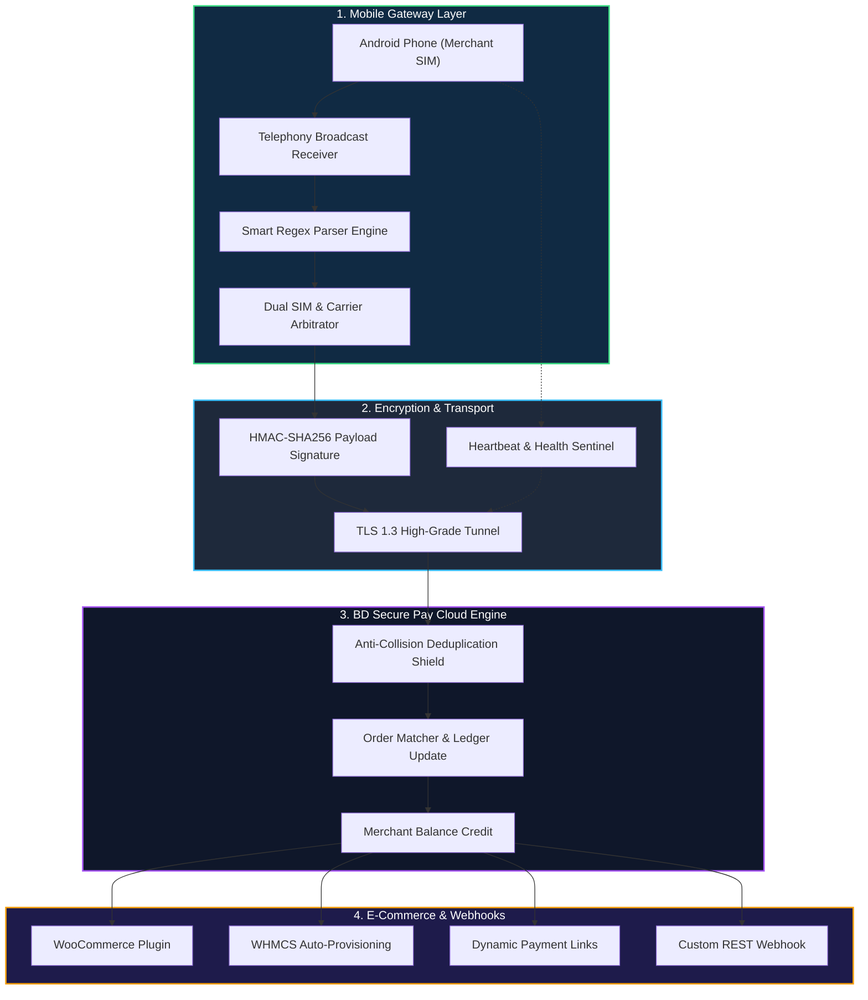
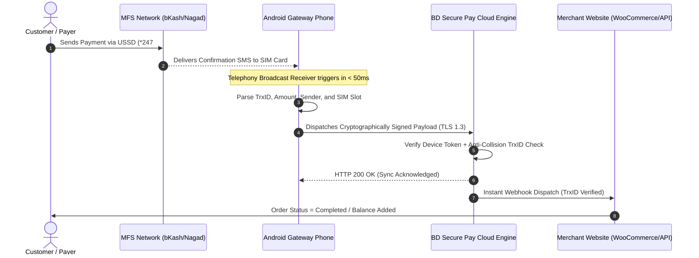

<div align="center">

  <!-- Official Site Logo Only -->
  <a href="https://bdsecurepay.com" target="_blank" rel="noopener noreferrer">
    
  </a>

  <br/><br/>

  <!-- Dynamic Animated Typing SVG Banner 1 (Hero Title) -->
  <a href="https://bdsecurepay.com">
    
  </a>

  <br/>

  <!-- Shields & Badges: Android Icon & Tech Badges (Non-Linkable as Requested) -->
  <p align="center">
    
    
    
    
    
  </p>

  <p align="center">
    <b>High-Performance, Real-Time Android SMS & Payment Verification Daemon for the BD Secure Pay Merchant Ecosystem.</b>
  </p>

  <!-- Interactive Quick Navigation -->
  <p align="center">
    <a href="#-about-bd-secure-pay"><b>🌐 About Platform</b></a> •
    <a href="#-animated-transaction-workflow-video-simulation"><b>🎬 Video Workflow</b></a> •
    <a href="#-core-ecosystem-pillars"><b>⚡ Core Pillars</b></a> •
    <a href="#-supported-mfs-channels"><b>💳 Supported Channels</b></a> •
    <a href="#-end-to-end-architecture"><b>🏗️ Architecture</b></a> •
    <a href="#-setup--merchant-onboarding"><b>🚀 Setup Guide</b></a> •
    <a href="#-247-device-persistence-guide"><b>🔋 24/7 Persistence</b></a> •
    <a href="#-contact--support"><b>📞 Contact & Support</b></a>
  </p>

</div>

---

## 🌐 About BD Secure Pay

**[BD Secure Pay](https://bdsecurepay.com)** is Bangladesh's premier next-generation automated payment gateway and merchant aggregator designed specifically for e-commerce platforms, digital service agencies, SaaS providers, and freelancers.

Traditional payment gateway integrations in Bangladesh usually entail lengthy corporate merchant approval processes, expensive setup charges, and rigid paperwork. **BD Secure Pay** revolutionizes the ecosystem by harmonizing physical Android SIM hardware with high-availability cloud servers. This empowers merchants to accept and auto-verify payments across all major Bangladeshi Mobile Financial Services (MFS) with **zero delays, 100% precision, and instantaneous order fulfillment**.

### 📊 Platform Comparison

| Feature Capability | BD Secure Pay | Traditional Manual Verification | Legacy Bank Gateways |
|:---|:---:|:---:|:---:|
| **Verification Latency** | **< 300 Milliseconds** | 5 – 30 Minutes | 2 – 5 Seconds |
| **Merchant Setup Time** | **Instant (Under 5 Minutes)** | None | 2 – 6 Weeks |
| **Trade License Required?** | **Optional (Personal / Merchant)** | Optional | Mandatory |
| **Instant Balance Credit** | **Fully Automated via Webhook** | High Manual Error Risk | Automated |
| **Duplicate TrxID Shield** | **Cryptographic Lock** | Prone to Double Spend | Strong Anti-Fraud |
| **Supported Channels** | **bKash, Nagad, Rocket, Upay, Cellfin** | Manual checking | Limited / Card focused |
| **24/7 Uninterrupted Daemon** | **High-Availability Foreground Service** | Human-dependent | Server-dependent |

---

## 🎬 Animated Transaction Workflow (Video Simulation)

Watch the progressive lifecycle of an automated transaction as it executes across the network in real time:

<div align="center">

  <!-- Dynamic Typing SVG Video-Type Pipeline -->
  

</div>

### 🖥️ Real-Time Telemetry Terminal Simulation

```text
[00:00:00.012] [SMS_RECEIVER]   ==> Incoming SMS from: "bKash" on SIM 1 (Grameenphone)
[00:00:00.015] [PARSER_ENGINE]  ==> Type: "Cash In" | TrxID: "9K28XA91LM" | Amount: 1,500.00 BDT
[00:00:00.018] [SECURITY]       ==> Generating HMAC-SHA256 signature using Device Secret
[00:00:00.065] [SECURE_DISPATCH] ==> POST [ENCRYPTED_GATEWAY_NODE] (HMAC-SHA256 Signed / TLS 1.3)
[00:00:00.180] [CLOUD_RESPONSE] ==> 200 OK | Status: "MATCHED_AND_CREDITED" | Latency: 115ms
[00:00:00.182] [WEBHOOK_SENT]   ==> Store Order #4819 marked as "Processing"
```

---

## ⚡ Core Ecosystem Pillars



### 1. 🚀 Sub-Second Android SMS Interception
Hooks straight into Android's low-level `Telephony.SMS_RECEIVED` broadcast intent. Operates instantaneously upon SMS delivery without battery-draining continuous polling.

### 2. 🧠 Intelligent MFS Parsing Matrix
* **bKash:** Auto-distinguishes between *Cash In*, *Send Money*, and *Merchant Payment*, precisely extracting Transaction ID, Sender Mobile, and Net Received Amount.
* **Nagad:** Parses official Nagad alerts, capturing Sender Number, TrxID, and Amount with 100% regex fidelity.
* **DBBL Rocket:** Supports 12-digit transaction structures and sender mobile suffixes.
* **Upay & Cellfin:** Complete dynamic regex matching for multi-banking compatibility.

### 3. 🔄 Dual SIM Multi-Slot Intelligence
* Automatically probes Dual SIM hardware slots.
* Identifies whether the payment SMS arrived on **SIM 1** or **SIM 2** and tags the telecom carrier (`Grameenphone`, `Banglalink`, `Robi`, `Airtel`, `Teletalk`).
* Facilitates multi-account balance splitting across separate SIM slots on a single smartphone.

### 4. 🔐 Dual Authentication Pairing
* **One-Tap Google Sign-In:** Authenticate with your merchant Google account and select your linked device name from an interactive bottom sheet.
* **Instant QR Code Scan:** Scan your device setup QR code from your web dashboard ([bdsecurepay.com/user/devices](https://bdsecurepay.com/user/devices)) for instantaneous binding.

### 5. 🔋 Proactive Device Health Sentinel
* **Live Heartbeat:** Reports device uptime, WiFi/Cellular signal quality, battery percentage, and phone temperature every 15 minutes.
* **Low Battery Alert (< 30%):** Automatically triggers proactive alert emails to the merchant before the phone shuts down, eliminating unexpected gateway offline periods.

### 6. 🛡️ Unbreakable Foreground Persistence
* Runs as an Android Foreground Service with a persistent notification chronometer.
* Built-in wake-lock management and Doze-mode bypass ensure the app is never killed by aggressive OEM battery cleaners.

---

## 💳 Supported MFS Channels

```
┌─────────────────────────────────────────────────────────────────────────────┐
│                       SUPPORTED PAYMENT PROVIDERS                           │
├──────────────────┬──────────────────┬──────────────────┬────────────────────┤
│   bKash (বিকাশ)   │   Nagad (নগদ)    │  Rocket (রকেট)   │   Upay / Cellfin   │
├──────────────────┼──────────────────┼──────────────────┼────────────────────┤
│ ✔ Personal       │ ✔ Personal       │ ✔ DBBL Rocket    │ ✔ Upay Personal    │
│ ✔ Agent          │ ✔ Merchant       │ ✔ 12-Digit TrxID │ ✔ Upay Merchant    │
│ ✔ Merchant Pay   │ ✔ Dynamic Webhook│ ✔ Webhook Sync   │ ✔ Cellfin Bank     │
└──────────────────┴──────────────────┴──────────────────┴────────────────────┘
```

---

## 🏗️ End-to-End Architecture



---

## 🚀 Setup & Merchant Onboarding

Setting up your Android phone as a high-speed payment gateway takes less than 3 minutes:

### Step 1: Install Gateway App
> **Notice:** Obtain the authorized Gateway Client application binary from our official releases or your [Merchant Device Portal](https://bdsecurepay.com/user/devices).

1. Install the APK on your dedicated Android phone.
2. If prompted with *"Install unknown apps"*, toggle **Allow from this source**.

### Step 2: Grant Permissions
Launch the app and grant the required Android permissions:
* **SMS (`RECEIVE_SMS`, `READ_SMS`):** Required to detect incoming MFS transaction alerts.
* **Phone State (`READ_PHONE_STATE`):** Required to distinguish between SIM 1 and SIM 2.
* **Notification (`POST_NOTIFICATIONS`):** Required on Android 13+ to keep the background foreground service alive.

### Step 3: Pair Device with Your Account
Choose either pairing method:
* **Method A (Google Sign-In):** Tap **Sign in with Google**, select your merchant Google account, and choose your device name from the bottom sheet.
* **Method B (QR Code Pairing):** Log in to your [Merchant Dashboard](https://bdsecurepay.com/user/devices), click **Add New Device**, and scan the QR code using the app.

### Step 4: Activate Gateway Service
* Toggle the **Start Gateway Service** switch to **ON**.
* The persistent notification status will switch to `BD Secure Pay Gateway Service is Running`.
* Your device will now show as **Online 🟢** on your merchant web dashboard.

---

## 🔋 24/7 Device Persistence Guide

Android manufacturers utilize aggressive battery management policies that can terminate background processes. Follow these one-time device optimizations to guarantee **uninterrupted 24/7 uptime**:

<details>
<summary><b>📱 Xiaomi / Redmi / POCO (MIUI / HyperOS)</b></summary>

1. **Security App** → **Manage Apps** → Find **BD Secure Pay**.
2. Turn ON **Autostart** (Allow background startup).
3. **Battery Saver** → Select **No Restrictions** *(Critical)*.
4. **App Permissions** → Set SMS and Phone state to **Always Allow**.
5. Open Recent Apps screen → Long-press BD Secure Pay → Tap the **Lock 🔒** icon to lock it in RAM.
</details>

<details>
<summary><b>📱 Samsung Galaxy (OneUI)</b></summary>

1. **Settings** → **Apps** → **BD Secure Pay** → **Battery** → Select **Unrestricted**.
2. **Settings** → **Battery & device care** → **Battery** → **Background usage limits** → Add BD Secure Pay to **Never sleeping apps**.
3. Open Recent Apps screen → Tap the BD Secure Pay icon → Tap **Lock this app**.
</details>

<details>
<summary><b>📱 Vivo / iQOO (Funtouch OS)</b></summary>

1. **Settings** → **Battery** → **High background power consumption** → Turn ON for **BD Secure Pay**.
2. **Settings** → **Applications & Permissions** → **Permission Management** → **Autostart** → Allow **BD Secure Pay**.
</details>

<details>
<summary><b>📱 Realme / Oppo / OnePlus (ColorOS / OxygenOS)</b></summary>

1. **Settings** → **Apps** → **BD Secure Pay** → **Battery Usage** → Enable **Allow Foreground Activity** and **Allow Background Activity**.
2. **Settings** → **Battery** → **More battery settings** → **Optimize battery use** → Select **Don't optimize**.
3. **Auto-launch** → Enable for **BD Secure Pay**.
</details>

---

## 🔒 Security & Privacy Standards

* **TLS 1.3 Transport Security:** Every byte exchanged between the Android client, cloud servers, and merchant webhooks is protected with high-grade TLS 1.3 / HTTPS encryption.
* **Local Regex Sandboxing:** The Android application exclusively filters messages matching approved financial sender titles (`bKash`, `NAGAD`, `16216`, `Upay`). All personal, private, or non-MFS messages are immediately discarded locally and never leave the phone.
* **Anti-Collision TrxID Deduplication:** The cloud engine enforces a strict database lock on every processed TrxID, making double-spending and duplicate verification mathematically impossible.
* **Zero Third-Party Telemetry:** No analytics libraries, third-party user trackers, or advertisement frameworks are bundled within the APK.

---

## 🌐 Real-Time Platform Links

* 🏠 **Main Portal:** [https://bdsecurepay.com](https://bdsecurepay.com)
* 📚 **Developer Documentation:** [https://bdsecurepay.com/developers](https://bdsecurepay.com/developers)
* 🔑 **Merchant Login:** [https://bdsecurepay.com/login](https://bdsecurepay.com/login)
* 📝 **Register Account:** [https://bdsecurepay.com/register](https://bdsecurepay.com/register)
* 📱 **Device Management:** [https://bdsecurepay.com/user/devices](https://bdsecurepay.com/user/devices)
* 💳 **Payment Links:** [https://bdsecurepay.com/user/paymentlink](https://bdsecurepay.com/user/paymentlink)
* 📄 **Terms of Service:** [https://bdsecurepay.com/terms](https://bdsecurepay.com/terms)
* 🛡️ **Privacy Policy:** [https://bdsecurepay.com/privacy](https://bdsecurepay.com/privacy)

---

## 📞 Contact & Support

Our technical support team is available 24/7 to assist with device pairing, integration, or custom solutions:

<div align="center">

  <a href="https://wa.me/8801570212139" target="_blank">
    
  </a>
  &nbsp;
  <a href="tel:+8801570212139">
    
  </a>
  &nbsp;
  <a href="mailto:bdhost.org1@gmail.com">
    
  </a>

  <br/><br/>

  <sub>Copyright © 2026 BD Secure Pay. All Rights Reserved. Built for high-frequency e-commerce automation in Bangladesh.</sub>

</div>
