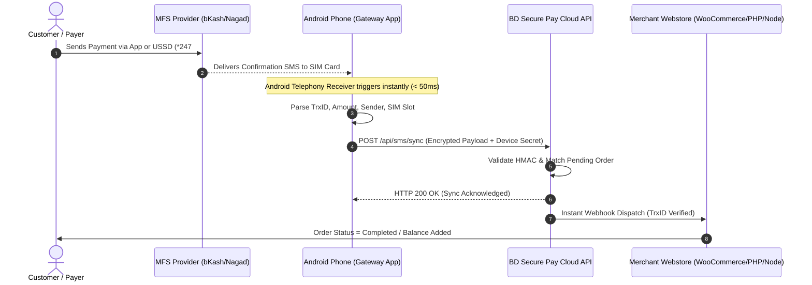

# ⚡ BD Secure Pay — Automated Android SMS Gateway

<div align="center">

  

  <br/>

  [](https://github.com/devhasanbd/bdsecurepay-gateway-app/releases/latest)
  [](https://developer.android.com/)
  [](https://github.com)
  [](https://bdsecurepay.com)
  [](https://bdsecurepay.com)

  <p align="center">
    <b>High-Performance, Real-Time Android SMS & Payment Forwarding Daemon for BD Secure Pay Merchants.</b><br/>
    Seamlessly synchronizes bKash, Nagad, Rocket, Upay, and Cellfin incoming SMS notifications directly with your merchant backend in milliseconds.
  </p>

  <p align="center">
    <a href="#-quick-download"><b>📥 Download Latest APK</b></a> •
    <a href="#-key-features"><b>✨ Features</b></a> •
    <a href="#-system-architecture"><b>🏗️ Architecture</b></a> •
    <a href="#-step-by-step-setup"><b>🚀 Setup Guide</b></a> •
    <a href="#-device-optimization-247-uptime"><b>🔋 24/7 Persistence</b></a> •
    <a href="#-security--privacy"><b>🔒 Security</b></a>
  </p>

</div>

---

## 📌 Overview

**BD Secure Pay Gateway** is an enterprise-grade Android client application built specifically for merchants in Bangladesh. It bridges physical Android SIM devices with the [BD Secure Pay Cloud Infrastructure](https://bdsecurepay.com). 

Whenever an MFS payment notification arrives via SMS (bKash Personal/Merchant, Nagad, Rocket, Upay), the gateway parses the transaction parameters (Sender Number, Transaction ID, Amount, Timestamp) with sub-second latency and securely relays the payload to your merchant webhook over an encrypted SSL/TLS connection.

```
+-------------------+       +-----------------------+       +-------------------------+
| Incoming MFS SMS  |  ==>  |  BD Secure Pay App    |  ==>  |   BD Secure Pay Cloud   |
| (bKash / Nagad)   |       |  (Instant Local Parse)|       |   (Instant Verification)|
+-------------------+       +-----------------------+       +-------------------------+
                                                                         ||
                                                                         \/
                                                            +-------------------------+
                                                            |  Merchant E-Commerce    |
                                                            |  (Auto Balance Credit)  |
                                                            +-------------------------+
```

---

## 📥 Quick Download

Get the latest production-tested binary directly from our verified GitHub release CDN:

<div align="center">

| App Version | Build Code | Min Android | Target Android | Direct Download |
|:---:|:---:|:---:|:---:|:---:|
| **v7.5 (Latest)** | `54` | Android 6.0 (API 23) | Android 14+ (API 34) | [**Download Bdsecurepay-v7.5.apk**](https://github.com/devhasanbd/bdsecurepay-gateway-app/releases/download/v7.5/Bdsecurepay-v7.5.apk) |
| **v7.4** | `53` | Android 6.0 (API 23) | Android 14 (API 34) | [Download Bdsecurepay-v7.4.apk](https://github.com/devhasanbd/bdsecurepay-gateway-app/releases/download/v7.4/Bdsecurepay-v7.4.apk) |

</div>

> **Notice:** All release APKs are cryptographically signed with our official release keystore and verified malware-free. Hosting on GitHub Releases ensures fast global downloads via Microsoft Azure edge servers without browser security false-positives.

---

## ✨ Key Features

### ⚡ Ultra-Fast SMS Interception & Regex Parsing
* Zero polling delay: Hooks directly into Android's low-level SMS broadcast receiver (`Telephony.SMS_RECEIVED`).
* Highly optimized regex engine tailored for Bangladeshi MFS SMS formats:
  * **bKash:** TrxID extraction, Cash In, Payment, Send Money detection.
  * **Nagad:** Auto parsing of Transaction ID, Sender Mobile, and Net Amount.
  * **Rocket:** 12-digit transaction matching and account suffix detection.
  * **Upay & Cellfin:** Complete dynamic regex matching.

### 🔄 Dual SIM Multi-Slot Support
* Automatically detects Dual SIM hardware.
* Identifies whether the SMS arrived on **SIM 1** or **SIM 2** and tags the carrier name (`Grameenphone`, `Banglalink`, `Robi`, `Airtel`, `Teletalk`).
* Merchants can link distinct payment accounts to separate physical SIM slots simultaneously.

### 🔐 Multi-Option Merchant Authentication
* **One-Tap Google Sign-In:** Instant merchant login using your verified merchant Google Account with a native bottom-sheet device selector.
* **Instant QR Code Pairing:** Simply scan the Device QR Code generated inside your [Merchant Portal](https://bdsecurepay.com/user/devices) to bind the device in under 3 seconds.

### 🔋 Proactive Device Health Sentinel
* **Live Heartbeat:** Reports device health, signal strength, network status (WiFi / 4G LTE), and phone model to the merchant dashboard every 15 minutes.
* **Low Battery Alert (< 30%):** Automatically alerts the merchant via email notification before the gateway phone powers down, avoiding transaction downtime.

### 🛡️ Unbreakable 24/7 Foreground Persistence
* Runs as an Android Foreground Service with an interactive notification tray chronometer.
* Immune to Android Doze mode, Deep Sleep, and OEM memory killers when configured with our simple persistence steps.

### 📲 Smart In-App Update Engine
* Built-in silent version checker against `version.json`.
* Merchant receives instant heads-up notification only when an actual newer release is published, with direct in-app upgrade support.

---

## 🏗️ System Architecture



---

## 🚀 Step-by-Step Setup

Follow these simple steps to set up the gateway device in under 3 minutes:

### 1️⃣ Download & Install APK
1. Download **`Bdsecurepay-v7.5.apk`** from [Releases](https://github.com/devhasanbd/bdsecurepay-gateway-app/releases/latest) onto your dedicated Android gateway phone.
2. Tap the downloaded file to install. If prompted with *"Install unknown apps"*, allow your browser/file manager permission.

### 2️⃣ Grant Required Permissions
When launching the app for the first time, grant the necessary Android system permissions:
* **SMS Permission:** Required to listen for incoming payment verification texts.
* **Phone State Permission:** Required to identify Dual SIM slots (`SIM 1` vs `SIM 2`).
* **Notification Permission (Android 13+):** Required to keep the foreground gateway service active in the background.

### 3️⃣ Pair Your Merchant Account
* **Option A (Google Login):** Tap **"Sign in with Google"**, choose your merchant email, and select your registered Device Name from the popup bottom sheet.
* **Option B (QR Code Pairing):** Log into your [BD Secure Pay Merchant Dashboard](https://bdsecurepay.com/user/devices), click **Add New Device**, and scan the on-screen QR Code using the app's built-in camera scanner.

### 4️⃣ Start the Gateway Service
* Toggle the **"Start Service"** switch to **ON**.
* You will see the persistent green status notification: `BD Secure Pay Gateway Service is Running`.
* Your device will immediately appear as **Online 🟢** in your merchant dashboard.

---

## 🔋 Device Optimization (24/7 Uptime)

Android manufacturers (Xiaomi, Samsung, Oppo, Vivo, Realme) have aggressive battery managers that can put background apps to sleep. To guarantee **100% 24/7 uptime**, perform these one-time phone settings:

<details>
<summary><b>📱 Xiaomi / Redmi / POCO (MIUI / HyperOS)</b></summary>

1. **Security App** → **Manage Apps** → Find **BD Secure Pay**.
2. Turn ON **Autostart** (Allow background startup).
3. **Battery Saver** → Select **No Restrictions** (Crucial).
4. **App Permissions** → Ensure SMS and Phone state are set to **Always Allow**.
5. Open Recent Apps screen → Long-press BD Secure Pay → Tap the **Lock 🔒** icon to keep it locked in RAM.
</details>

<details>
<summary><b>📱 Samsung (OneUI)</b></summary>

1. **Settings** → **Apps** → **BD Secure Pay** → **Battery** → Select **Unrestricted**.
2. **Settings** → **Battery and device care** → **Battery** → **Background usage limits** → Ensure BD Secure Pay is in **Never sleeping apps**.
3. Open Recent Apps → Tap the BD Secure Pay icon → Tap **Lock this app**.
</details>

<details>
<summary><b>📱 Vivo / iQOO (Funtouch OS)</b></summary>

1. **Settings** → **Battery** → **High background power consumption** → Enable **BD Secure Pay**.
2. **Settings** → **Applications and Permissions** → **Permission Management** → **Autostart** → Enable **BD Secure Pay**.
</details>

<details>
<summary><b>📱 Realme / Oppo / OnePlus (ColorOS / OxygenOS / Realme UI)</b></summary>

1. **Settings** → **Apps** → **BD Secure Pay** → **Battery Usage** → Allow **Foregound Activity** and **Background Activity**.
2. **Settings** → **Battery** → **More battery settings** → **Optimize battery use** → Find BD Secure Pay → Select **Don't optimize**.
3. **Auto-launch** → Allow BD Secure Pay to auto-launch.
</details>

---

## 🔒 Security & Privacy

We adhere to the highest security and compliance standards:
* **End-to-End Encryption:** All webhook synchronization requests are signed with your unique Device API Secret and transmitted over TLS 1.3 / HTTPS.
* **Strict Filter Scope:** The application strictly isolates and parses messages sent from verified financial sender IDs (`bKash`, `NAGAD`, `16216`, `Upay`, etc.). All personal or unrelated SMS messages are completely ignored and never transmitted.
* **Zero Third-Party Telemetry:** No user analytics, trackers, or foreign ad SDKs are included in the build.
* **Cryptographically Signed:** Official binaries are signed with our verified release keystore (`bdsecurepay_release.jks`).

---

## 📡 Webhook Payload Example

When an SMS arrives, the app relays the following structured JSON payload to the BD Secure Pay server:

```json
{
  "device_id": "DEV-8921-X",
  "device_secret": "sec_live_948f20bca87192",
  "sender": "bKash",
  "sim_slot": 1,
  "sim_carrier": "Grameenphone",
  "raw_sms": "You have received Tk 1,500.00 from 017XXXXXXXX. Fee Tk 0.00. Balance Tk 4,520.00. TrxID 9K28XA91LM at 10/11/2026 21:05",
  "parsed_data": {
    "provider": "bkash",
    "trx_id": "9K28XA91LM",
    "amount": 1500.00,
    "fee": 0.00,
    "customer_mobile": "017XXXXXXXX",
    "type": "cash_in",
    "timestamp": 1794324300
  },
  "battery_level": 88,
  "is_charging": true,
  "app_version": "7.5"
}
```

---

## 💬 Support & Inquiries

Need assistance with device setup, multi-merchant configuration, or API integrations?

* 🌐 **Official Website:** [https://bdsecurepay.com](https://bdsecurepay.com)
* 📖 **Merchant Documentation:** [https://bdsecurepay.com/docs](https://bdsecurepay.com/docs)
* 📧 **Email Support:** support@bdsecurepay.com
* 💬 **Live Helpdesk:** Available inside your merchant portal dashboard

---

<div align="center">
  <sub>Copyright © 2026 BD Secure Pay. All Rights Reserved. Built with ❤️ for Bangladeshi Digital Merchants.</sub>
</div>
