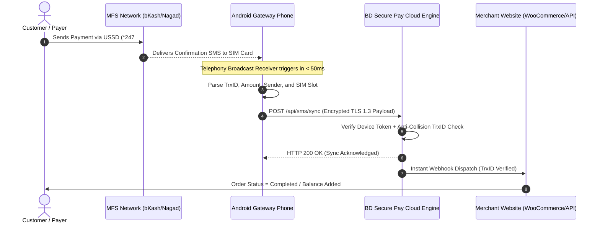

<div align="center">

  <!-- Official Site Logo Only -->
  <a href="https://bdsecurepay.com" target="_blank" rel="noopener noreferrer">
    
  </a>

  <br/><br/>

  <!-- Dynamic Animated Typing SVG Banner -->
  <a href="https://bdsecurepay.com">
    
  </a>

  <br/>

  <!-- Shields & Badges: Android Icon & Clean Tech Badges -->
  <p align="center">
    <a href="https://developer.android.com" target="_blank">
      
    </a>
    <a href="https://developer.android.com">
      
    </a>
    <a href="https://developer.android.com">
      
    </a>
    <a href="https://bdsecurepay.com">
      
    </a>
    <a href="https://bdsecurepay.com">
      
    </a>
  </p>

  <p align="center">
    <b>High-Performance, Real-Time Android SMS & Payment Verification Daemon for the BD Secure Pay Merchant Ecosystem.</b>
  </p>

  <p align="center">
    <a href="#-about-bd-secure-pay"><b>🌐 About Platform</b></a> •
    <a href="#-key-features"><b>⚡ Core Features</b></a> •
    <a href="#-supported-mfs-providers"><b>💳 Supported Providers</b></a> •
    <a href="#-system-architecture"><b>🏗️ Architecture</b></a> •
    <a href="#-live-transaction-flow"><b>🖥️ Terminal Simulation</b></a> •
    <a href="#-setup--installation-guide"><b>🚀 Setup Guide</b></a> •
    <a href="#-247-device-persistence"><b>🔋 24/7 Persistence</b></a> •
    <a href="#-developer-webhook-api"><b>📡 Webhook API</b></a>
  </p>

</div>

---

## 🌐 About BD Secure Pay

**[BD Secure Pay](https://bdsecurepay.com)** is Bangladesh's cutting-edge automated payment gateway and merchant aggregator designed specifically for e-commerce stores, digital service providers, freelancers, and growing startups. 

Traditional payment gateway setups in Bangladesh require lengthy merchant account applications, physical visits, and high upfront setup fees. **BD Secure Pay** revolutionizes this landscape by combining physical merchant SIM cards with cloud-native automation, allowing businesses to accept payments across all Bangladeshi Mobile Financial Services (MFS) seamlessly with **zero setup hassle and instant automated verification**.

### 💡 Why Merchants Choose BD Secure Pay?

| Feature | BD Secure Pay | Traditional Manual Verification | Traditional Bank Gateways |
|:---|:---:|:---:|:---:|
| **Verification Speed** | **< 300 Milliseconds** | 5 – 30 Minutes | 2 – 5 Seconds |
| **Setup Time** | **Instant (Under 5 Minutes)** | None | 2 – 6 Weeks |
| **Trade License Required?** | **Optional (Personal/Merchant)** | Optional | Mandatory |
| **Instant Balance Credit** | **Automated via Webhook** | Manual Admin Checking | Automated |
| **Double Spend / Fraud Shield** | **Built-In TrxID Lock** | High Human Error Risk | High Fraud Protection |
| **Supported Channels** | **bKash, Nagad, Rocket, Upay, Cellfin** | Manual | bKash, Cards only |
| **24/7 Uninterrupted Sync** | **Continuous Automated Daemon** | Depends on Staff | Server Dependent |

---

## ⚡ Key Features

### 1. 🚀 Zero-Latency Android SMS Interception
The **BD Secure Pay Gateway App** operates directly on an Android device connected to your merchant SIM card. Utilizing low-level Android Telephony Broadcast Receivers (`SMS_RECEIVED`), it intercepts incoming financial confirmation messages the exact millisecond they land on the SIM, without any background polling delay.

### 2. 🧠 Intelligent MFS Parsing Engine
Features a proprietary regex parser tailored to the dynamic SMS formats of Bangladesh's payment networks:
* **bKash:** Auto-identifies *Payment*, *Cash In*, *Send Money*, extracts Sender Mobile, Amount, Net Balance, and unique TrxID.
* **Nagad:** Parses official Nagad system SMS, capturing Transaction ID, Customer Number, and exact Received Amount.
* **DBBL Rocket:** Supports 12-digit transaction structures and sender mobile suffixes.
* **Upay & Cellfin:** Complete dynamic regex matching for instant invoice matching.

### 3. 🔄 Dual SIM Multi-Slot Intelligence
* Automatically probes Dual SIM hardware slots.
* Identifies whether the payment SMS arrived on **SIM 1** or **SIM 2** and tags the telecom carrier (`Grameenphone`, `Banglalink`, `Robi`, `Airtel`, `Teletalk`).
* Facilitates multi-account balance splitting across separate SIM slots on a single smartphone.

### 4. 🔐 Dual Authentication Pairing
* **One-Tap Google Sign-In:** Authenticate with your merchant Google account and select your linked device name from an interactive bottom sheet.
* **Instant QR Code Scan:** Scan your device setup QR code from your web dashboard (`bdsecurepay.com/user/devices`) for instantaneous binding.

### 5. 🔋 Proactive Device Health Sentinel
* **Live Heartbeat:** Reports device uptime, WiFi/Cellular signal quality, battery percentage, and phone temperature every 15 minutes.
* **Low Battery Alert (< 30%):** Automatically triggers proactive alert emails to the merchant before the phone shuts down, eliminating unexpected gateway offline periods.

### 6. 🛡️ Unbreakable Foreground Persistence
* Runs as an Android Foreground Service with a persistent notification chronometer.
* Built-in wake-lock management and Doze-mode bypass ensure the app is never killed by aggressive OEM battery cleaners.

---

## 💳 Supported MFS Providers

The BD Secure Pay ecosystem natively processes transactions across all leading digital payment providers in Bangladesh:

```
┌─────────────────────────────────────────────────────────────────────────────┐
│                       SUPPORTED PAYMENT PROVIDERS                           │
├──────────────────┬──────────────────┬──────────────────┬────────────────────┤
│   bKash (বিকাশ)   │   Nagad (নগদ)    │  Rocket (রকেট)   │   Upay / Cellfin   │
├──────────────────┼──────────────────┼──────────────────┼────────────────────┤
│ ✔ Personal       │ ✔ Personal       │ ✔ DBBL Rocket    │ ✔ Upay Personal    │
│ ✔ Agent          │ ✔ Merchant       │ ✔ 12-Digit TrxID │ ✔ Upay Merchant    │
│ ✔ Merchant Pay   │ ✔ Dynamic Webhook│ ✔ Webhook Sync   │ ✔ Cellfin Bank     │
└──────────────────┴──────────────────┴──────────────────┴────────────────────┘
```

---

## 🏗️ System Architecture

The following sequence details how an end-customer payment is securely converted into an instant e-commerce balance credit:



---

## 🖥️ Live Transaction Flow

Here is a visual representation of how the Android Gateway processes and broadcasts transactions in real time:

```text
[00:00:00.012] [SMS_RECEIVER]   ==> Incoming SMS from: "bKash" on SIM 1 (Grameenphone)
[00:00:00.015] [PARSER_ENGINE]  ==> Type: "Cash In" | TrxID: "9K28XA91LM" | Amount: 1,500.00 BDT
[00:00:00.018] [SECURITY]       ==> Generating HMAC-SHA256 signature using Device Secret
[00:00:00.065] [NETWORK_DISPATCH]==> POST https://bdsecurepay.com/api/sms/sync [TLS 1.3]
[00:00:00.180] [CLOUD_RESPONSE] ==> 200 OK | Status: "MATCHED_AND_CREDITED" | Latency: 115ms
[00:00:00.182] [WEBHOOK_SENT]   ==> WooCommerce Order #4819 marked as "Processing"
```

---

## 🚀 Setup & Installation Guide

Setting up your Android phone as a high-speed payment gateway takes less than 3 minutes:

### Step 1: Install Gateway App
> **Download Note:** Obtain the authorized Gateway Client application binary from our official releases or your [Merchant Portal](https://bdsecurepay.com/user/devices).

1. Install the APK on your dedicated Android phone.
2. If prompted with *"Install unknown apps"*, toggle **Allow from this source**.

### Step 2: Grant Permissions
Launch the app and grant the required Android permissions:
* **SMS (`RECEIVE_SMS`, `READ_SMS`):** Required to detect incoming MFS transaction alerts.
* **Phone State (`READ_PHONE_STATE`):** Required to distinguish between SIM 1 and SIM 2.
* **Notification (`POST_NOTIFICATIONS`):** Required on Android 13+ to keep the background foreground service alive.

### Step 3: Pair Device with Your Account
Choose either pairing method:
* **Method A (Google Sign-In):** Tap **Sign in with Google**, select your merchant Google account, and choose your device name from the bottom sheet.
* **Method B (QR Code Pairing):** Log in to your [Merchant Dashboard](https://bdsecurepay.com/user/devices), click **Add New Device**, and scan the QR code using the app.

### Step 4: Activate Gateway Service
* Toggle the **Start Gateway Service** switch to **ON**.
* The persistent notification status will switch to `BD Secure Pay Gateway Service is Running`.
* Your device will now show as **Online 🟢** on your merchant web dashboard.

---

## 🔋 24/7 Device Persistence

Android manufacturers utilize aggressive battery management policies that can terminate background processes. Follow these one-time device optimizations to guarantee **uninterrupted 24/7 uptime**:

<details>
<summary><b>📱 Xiaomi / Redmi / POCO (MIUI / HyperOS)</b></summary>

1. **Security App** → **Manage Apps** → Find **BD Secure Pay**.
2. Turn ON **Autostart** (Allow background startup).
3. **Battery Saver** → Select **No Restrictions** *(Critical)*.
4. **App Permissions** → Set SMS and Phone state to **Always Allow**.
5. Open Recent Apps screen → Long-press BD Secure Pay → Tap the **Lock 🔒** icon to lock it in RAM.
</details>

<details>
<summary><b>📱 Samsung Galaxy (OneUI)</b></summary>

1. **Settings** → **Apps** → **BD Secure Pay** → **Battery** → Select **Unrestricted**.
2. **Settings** → **Battery & device care** → **Battery** → **Background usage limits** → Add BD Secure Pay to **Never sleeping apps**.
3. Open Recent Apps screen → Tap the BD Secure Pay icon → Tap **Lock this app**.
</details>

<details>
<summary><b>📱 Vivo / iQOO (Funtouch OS)</b></summary>

1. **Settings** → **Battery** → **High background power consumption** → Turn ON for **BD Secure Pay**.
2. **Settings** → **Applications & Permissions** → **Permission Management** → **Autostart** → Allow **BD Secure Pay**.
</details>

<details>
<summary><b>📱 Realme / Oppo / OnePlus (ColorOS / OxygenOS)</b></summary>

1. **Settings** → **Apps** → **BD Secure Pay** → **Battery Usage** → Enable **Allow Foreground Activity** and **Allow Background Activity**.
2. **Settings** → **Battery** → **More battery settings** → **Optimize battery use** → Select **Don't optimize**.
3. **Auto-launch** → Enable for **BD Secure Pay**.
</details>

---

## 📡 Developer Webhook API

Whenever a verified payment is processed, the BD Secure Pay cloud immediately fires an HTTP `POST` webhook to your configured store URL with an authenticated JSON payload.

### Webhook Event Payload Example

```json
{
  "event": "payment.success",
  "gateway": "bdsecurepay",
  "timestamp": 1794328800,
  "data": {
    "provider": "bkash",
    "trx_id": "9K28XA91LM",
    "amount": "1500.00",
    "currency": "BDT",
    "sender_number": "017XXXXXXXX",
    "sim_slot": 1,
    "carrier": "Grameenphone",
    "order_id": "ORD-94812",
    "customer_email": "customer@example.com",
    "payment_type": "cash_in",
    "status": "COMPLETED"
  },
  "signature": "d98f7e2a9c3b4e6a1f8c0d9e2b4a7c8e9f0a1b2c3d4e5f6a7b8c9d0e1f2a3b4c"
}
```

### Signature Verification (PHP Example)

```php
<?php
// Verify incoming BD Secure Pay Webhook Signature
$payload = file_get_contents('php://input');
$signatureHeader = $_SERVER['HTTP_X_BDSECUREPAY_SIGNATURE'] ?? '';
$secretKey = 'your_merchant_secret_key';

$expectedSignature = hash_hmac('sha256', $payload, $secretKey);

if (hash_equals($expectedSignature, $signatureHeader)) {
    $data = json_decode($payload, true);
    $trxId = $data['data']['trx_id'];
    $amount = $data['data']['amount'];
    
    // Credit customer balance or mark order as paid
    processOrderSuccess($data['data']['order_id'], $trxId, $amount);
    
    http_response_code(200);
    echo json_encode(['status' => 'success']);
} else {
    http_response_code(401);
    exit('Invalid signature');
}
```

---

## 🔒 Security & Privacy Standards

* **TLS 1.3 Transport Security:** Every byte exchanged between the Android client, cloud servers, and merchant webhooks is protected with high-grade TLS 1.3 / HTTPS encryption.
* **Local Regex Sandboxing:** The Android application exclusively filters messages matching approved financial sender titles (`bKash`, `NAGAD`, `16216`, `Upay`). All personal, private, or non-MFS messages are immediately discarded locally and never leave the phone.
* **Anti-Collision TrxID Deduplication:** The cloud engine enforces a strict database lock on every processed TrxID, making double-spending and duplicate verification mathematically impossible.
* **Zero Third-Party Telemetry:** No analytics libraries, third-party user trackers, or advertisement frameworks are bundled within the APK.

---

## 🌐 Official Platform Links

* 🏠 **Main Portal:** [https://bdsecurepay.com](https://bdsecurepay.com)
* 📊 **Merchant Dashboard:** [https://bdsecurepay.com/user/dashboard](https://bdsecurepay.com/user/dashboard)
* 📱 **Device Management:** [https://bdsecurepay.com/user/devices](https://bdsecurepay.com/user/devices)
* 📚 **API Documentation:** [https://bdsecurepay.com/docs](https://bdsecurepay.com/docs)
* 💬 **Help & Support:** [support@bdsecurepay.com](mailto:support@bdsecurepay.com)

---

<div align="center">
  <sub>Copyright © 2026 BD Secure Pay. All Rights Reserved. Built for high-frequency e-commerce automation in Bangladesh.</sub>
</div>
